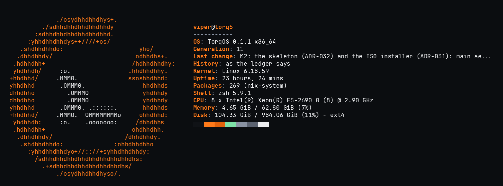
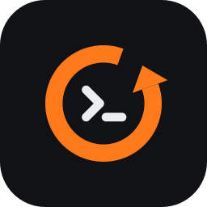

<p align="center">
  <picture>
    <source media="(prefers-color-scheme: dark)" srcset="branding/svg/lockup/torqos-lockup-for-dark-transparent.svg">
    
  </picture>
</p>

<h3 align="center"><code>set</code> &nbsp;|&nbsp; <code>commit</code> &nbsp;|&nbsp; <code>rollback</code></h3>

<p align="center">
  <strong>The configuration is the device.</strong><br>
  A thin, command-line operating system built on NixOS, where every change to the machine is<br>
  committed, recorded and reversible.
</p>

<p align="center">
  <a href="https://github.com/netstacks/torqos-releases/releases/latest"></a>
  <a href="https://github.com/netstacks/torqos/actions/workflows/test.yml"></a>
  <a href="LICENSE"></a>
  
  
</p>

<p align="center">
  <a href="https://torqos.org"><strong>torqos.org</strong></a> &nbsp;·&nbsp;
  <a href="https://docs.torqos.org">Documentation</a> &nbsp;·&nbsp;
  <a href="https://github.com/netstacks/torqos-releases/releases/latest">Download</a> &nbsp;·&nbsp;
  <a href="docs/INSTALL.md">Install</a> &nbsp;·&nbsp;
  <a href="docs/ROADMAP.md">Roadmap</a> &nbsp;·&nbsp;
  <a href="branding/README.md">Brand</a>
</p>

<p align="center">
  
</p>

---

## What TorqOS is

TorqOS is an operating system you configure the way you configure a router or a switch. The whole
machine (its services, users, packages, network, boot, and everything else NixOS can describe) is
**one configuration tree**. You change it from `torqcli`, a shell with operational and configuration
modes, a private candidate, `show | compare`, `commit`, `commit confirmed` and `rollback`.

Underneath, it is NixOS. Each commit becomes a git commit in the machine's own configuration
repository and a bootable NixOS generation, made by a small privileged **broker**, the only program
allowed to write that repository. Every step goes into a **tamper-evident ledger**, and any change
comes undone with one command.

It has **one base and two faces**:

<table>
  <tr>
    <td width="50%" valign="top">
      <h4>🖥️&nbsp; The server, as code</h4>
      A machine defined in code, in git, driven by <code>torqcli</code> and rebuilt from its
      repository anywhere. Every change reviewed with <code>show | compare</code>, applied with
      <code>commit</code>, undone with <code>rollback</code>. <b>This is TorqOS today.</b>
    </td>
    <td width="50%" valign="top">
      <h4>🤖&nbsp; The machine an AI can drive</h4>
      The same base with a desktop configuration on it, where an agent <i>proposes</i>, a person
      approves, and anything it did can be undone. The agent never gets root and never bypasses
      the broker. <b>Being built:</b> M3–M5 of the <a href="docs/ROADMAP.md">roadmap</a>.
    </td>
  </tr>
</table>

> [!NOTE]
> **Status:** early releases (`v0.1.x`). The configuration layer is complete and in daily use; the
> images, first-boot setup, signed releases and the ISO installer are new. See
> [Project status](#project-status).

## Contents

- [Highlights](#highlights)
- [A first session](#a-first-session)
- [Install](#install)
- [Updates](#updates)
- [How it works](#how-it-works)
- [Security](#security)
- [Project status](#project-status)
- [Building from source](#building-from-source)
- [Repository layout](#repository-layout)
- [Documentation](#documentation)
- [Brand](#brand)
- [Contributing](#contributing)
- [Licence](#licence)

## Highlights

| | |
|---|---|
| 🌳 **One configuration tree** | Every NixOS setting, generated from the system's own options, with `?` help, Tab completion and abbreviations. `show configuration` is the whole machine; what is not a value (a hardware file, a module of your own) is a plain Nix file attached to the tree. |
| 🔁 **A network device's commit model** | Edit a private candidate, compare it with what runs, `commit check` to build without switching, `commit` to apply. `commit confirmed 5` rolls itself back unless you confirm it: the safe way to change SSH or networking on a remote machine. |
| ⏪ **Everything reversible** | `rollback <n>` loads any earlier configuration into the candidate; `request system revert #85` undoes one recorded change; the boot menu keeps every generation, and a commit confirmed that a power cut interrupts is rolled back at the next start. |
| 🔗 **A tamper-evident history** | Each proposal and change is a line in a hash-chained ledger: who asked, who approved, what changed, the system it produced. The machine checks at boot and every 15 minutes that it is what the ledger says. |
| ✍️ **One writer** | Only the broker writes the configuration repository. NixOS's tools for changing a machine are not on it, and a machine that drifts from its ledger says so. |
| 🔒 **Secure by default** | Nothing listens on the network until you ask. Root is locked. SSH, once on, is keys only unless passwords are allowed, the owner only, never root, with password guessing blocked. |
| 📦 **Signed releases** | Images come with signed checksums, and a machine checks the release key's signature on every update before loading it. Nothing unfree is in an image, and each release says where its source is. |
| 🪶 **Thin** | No desktop, no graphical stack, no installer tools on an installed machine: a new machine's system is held under a size budget CI enforces. |

## A first session

`torqcli` starts in operational mode. `configure` enters configuration mode, where changes go to
your candidate until you commit them.

```text
alice@torq> show system alarms
alice@torq> configure
alice@torq# set services openssh enable true
alice@torq# set environment systemPackages htop
alice@torq# show | compare
[edit environment]
+   systemPackages [ htop ];
[edit services openssh]
+   enable true;
alice@torq# commit check
alice@torq# commit confirmed 5 comment "SSH on, keys only; htop"
alice@torq# commit
```

`commit confirmed 5` shows the comparison and the keys that will be able to log in, asks, applies
the change, and rolls it back by itself in five minutes unless the second `commit` confirms it.

| Command | What it does |
|---|---|
| `show configuration` | The whole active configuration (`\| display set` prints it as `set` lines) |
| `show system ledger` | Every recorded change, newest first, with its number (`#85`) |
| `rollback 1` | Load the previous configuration into the candidate, to review and commit |
| `request system revert #85` | Undo one recorded change |
| `request system update` | Move the machine to the newest signed TorqOS release |
| `request system password alice` | Change a password (kept outside the configuration) |
| `show users` | People, their groups and who is logged in |
| `help`, `?` | Help for any command or setting, wherever you are |

Scripts use the same commands: `torqcli show system alarms`, or
`torqcli -c "configure; set users users alice packages htop; commit"`. Output filters are the real
tools, sandboxed: `show configuration | grep -i ssh | wc -l`.

The full design is in [docs/CLI-DESIGN.md](docs/CLI-DESIGN.md), the tree in
[docs/CONFIG-IS-THE-DEVICE.md](docs/CONFIG-IS-THE-DEVICE.md).

## Install

TorqOS is installed from an image: download it, check it, boot it, answer a few questions.

**1. Download** from the [latest release](https://github.com/netstacks/torqos-releases/releases/latest):

| File | For |
|---|---|
| `torqos-x86_64-linux.qcow2` | QEMU/KVM, Proxmox VE, libvirt (x86_64) |
| `torqos-x86_64-linux.vmdk.gz` | VMware ESXi (x86_64); `gunzip` it first |
| `torqos-x86_64-linux.iso` | A real machine: the installer, written to a USB stick as it is (from `v0.2.0`) |

x86_64 only while TorqOS is in development; aarch64 images come back with the first stable
release (v0.2.0 and earlier have them too).

**2. Check it**, with the release's `SHA256SUMS`, `SHA256SUMS.sig` and `allowed_signers`, using only
OpenSSH and coreutils:

```sh
ssh-keygen -Y verify -f allowed_signers -I torqos-release -n file -s SHA256SUMS.sig < SHA256SUMS
sha256sum -c --ignore-missing SHA256SUMS
```

The first command reports `Good "file" signature for torqos-release with ED25519 key SHA256:…`.
Compare that fingerprint with the one in the release notes and in this repository
([release/allowed_signers](release/allowed_signers)), so the key is not just the download's word.

**3. Boot it** as a UEFI virtual machine with a display, or boot the installer on a real machine:
it lists the machine's disks, never its own, asks you to name the one to erase, writes TorqOS to it,
reads it back, and leaves the machine's detected hardware for setup. The image has no user account,
root is locked, SSH is off and nothing listens on the network: the console shows first-boot setup.

**4. Answer setup's questions**, asked once, like a network device's initial dialog: the machine's
name and time zone, your user name and password, and whether to allow logging in from other
machines (not at all, by password, by SSH key, or both; the default is not at all). Setup writes the
configuration, the broker builds and switches to it, and records it as change #1.

Step by step, for each hypervisor and for real hardware: [docs/INSTALL.md](docs/INSTALL.md).

## Updates

Releases are published to [netstacks/torqos-releases](https://github.com/netstacks/torqos-releases):
each a git commit signed with the TorqOS release key, with `stable` moved forward only to releases
that passed the tests. On a machine:

```text
alice@torq> request system update
alice@torq> configure
alice@torq# show | compare
alice@torq# commit
```

`request system update` loads the newest software into your candidate, after verifying the
release's signature against the key the machine trusts (`/etc/torq/release-signers`): an unsigned or
wrongly signed release is refused and nothing is loaded. You see the change before committing it, and
`request system software rollback <n>` goes back to an earlier version. Almost everything comes
pre-built and signed from NixOS's binary cache; the machine builds only TorqOS's own small pieces.

## How it works

```text
┌──────────────────────────────────────────────────────────────────┐
│ torqcli      the shell: the tree, the candidate, compare, commit │
│              (people today; later, proposals from an agent)      │
├──────────────────────────────────────────────────────────────────┤
│ torq-broker  the only writer of the configuration repository:    │
│              checks, commits, builds, switches, confirms,        │
│              rolls back; appends every step to the ledger        │
├──────────────────────────────────────────────────────────────────┤
│ NixOS        the configuration repository (/var/lib/torq/config) │
│              → a NixOS generation, bootable, listed at boot      │
└──────────────────────────────────────────────────────────────────┘
```

A commit travels like this:

1. `torqcli` sends the difference between the configuration your candidate started from and your
   candidate to the broker, as one proposal, with your comment.
2. The broker checks it: the base is still current, nothing touches what only the broker may
   change, and a system change has a person's approval at a terminal.
3. It commits the change to the configuration repository, builds the new system and switches to it.
   A change that does not build changes nothing.
4. It appends the outcome to the ledger: the proposal, who approved it, the commit and the system.
5. A confirmed commit waits for confirmation; unconfirmed, the broker restores the previous system
   and configuration by itself, and records that too.

Two repositories, on purpose: **this one** is the distribution (NixOS modules, the broker and the
shell), built the same way by everyone; **each machine's configuration repository** is a small flake
that imports a TorqOS release and holds that machine's settings, written only by its broker. See
[docs/ARCHITECTURE.md](docs/ARCHITECTURE.md).

## Security

- **Nothing listens unless asked.** No SSH, no link-local name answering (LLMNR, mDNS): checked on
  the image by a VM test.
- **No default password.** Root is locked and never logs in over SSH; the owner's account is made at
  first boot. Passwords live outside the configuration repository, readable by the system only, so
  their hashes are not in its history.
- **SSH, safely, however it is turned on:** keys only unless passwords are allowed, three attempts per
  connection, the owner only (changeable), never root; with passwords, addresses that keep guessing
  are blocked at the firewall. A commit that changes who can log in shows it, and is refused if it
  would leave nobody able to.
- **The configuration cannot reach the broker.** Settings that would change what the broker runs, its
  files in `/etc`, its units, or TorqOS itself are refused when the system is evaluated, however they
  are spelled.
- **Signed releases**, for images and for updates, checked with OpenSSH alone.
- **An auditable history.** The ledger is hash-chained; `torq-broker verify` detects an entry edited, added or removed inside the chain (root can still rewrite it whole, or cut its newest entries: anchoring it off the machine is M3).
- **Privileged code is small Rust**, with `unsafe` and dead code forbidden by the compiler.

The threat model, what is and is not protected today, and the plan for owner-rooted boot security are
in [docs/SECURITY-MODEL.md](docs/SECURITY-MODEL.md); open issues are tracked openly in
[docs/KNOWN-GAPS.md](docs/KNOWN-GAPS.md). Please report a suspected vulnerability privately to the
maintainers rather than in a public issue.

## Project status

| Milestone | | State |
|---|:---:|---|
| **M1** — the trust loop: propose, apply, rebuild, ledger, one-command rollback | ✅ | Done |
| **M1.5** — `torqcli`: the tree, the candidate, the commit model | ✅ | Done; a usability study with new users is next |
| **M2** — install: images, first-boot setup, signed releases, the ISO installer, a thin base | 🟧 | Built and tested: images (qcow2, VMDK; x86_64, aarch64), setup, signed releases, CI, the ISO installer, the skeleton base, the boot-menu test, the source statement and the unfree check. Left: the end-of-milestone audit, then `v0.2.0` |
| **M3** — trust: identity from the kernel, the agent's account, the config repo's remote, strict mode | ⬜ | Designed (ADR-035, ADR-036) |
| **M4** — the desktop as a configuration, applications, data | ⬜ | Designed (ADR-034, ADR-037, ADR-038) |
| **M5** — the agent: doctor mode, proposals, session trust | ⬜ | Designed ([docs/AI-LAYER.md](docs/AI-LAYER.md)) |
| Later — owner-rooted boot security: the owner's Secure Boot keys, TPM2 | ⬜ | Designed (ADR-033, [docs/SECURITY-MODEL.md](docs/SECURITY-MODEL.md)) |

The roadmap is [docs/ROADMAP.md](docs/ROADMAP.md); design decisions and their reasons are recorded as
ADRs in [docs/DECISIONS.md](docs/DECISIONS.md).

## Building from source

You need Nix with flakes, on Linux (x86_64 or aarch64). The VM tests need KVM to run quickly; they
fall back to emulation without it.

```sh
nix flake check                                  # everything below
nix build .#image                                # the qcow2 image (.#image-vmdk for ESXi)
nix build .#iso                                  # the ISO installer
nix build .#checks.x86_64-linux.trust-loop       # one VM test
nix develop -c sh -c 'cd cli && cargo test'      # torqcli's unit tests
nix develop -c sh -c 'cd broker && cargo test'   # the broker's unit tests
```

| Check | What it proves |
|---|---|
| `tree` | The configuration tree is read as documented, and what it may never set is refused (evaluation only) |
| `trust-loop` | Commits, confirmed commits, rollbacks, the ledger and the shell, on a real NixOS |
| `socket` | The broker's door: who is asking is the kernel's answer; a system change takes an administrator's password; five wrong lock it, at sudo and su too |
| `agent` | The agent's account proposes only what its list allows, every refusal ledgered; a person sees what a proposal does and applies it |
| `agent-run` | A program (Claude Code) run as the agent: one shared directory, nothing else of any home, nothing that outlives it |
| `remote` | Every change pushed to the remote; a ledger cut short or rewritten here — or pushed on top by root — is an alarm |
| `adopt` | A new machine chooses a repository at setup and becomes that machine: its history goes on, with its own hardware, software and password |
| `snapshots` | A snapshot of the data before each change, read only, the ledger never in one; a restore runs as the folder's owner, so a planted link leads nowhere they could not go |
| `strict` | An administrator's sudo runs break-glass and the agent's launcher and nothing else; a root shell leaves its ledger entry, and pushes it, before it opens |
| `accounts`, `ssh` | Who can log in, and how; passwords never in the configuration |
| `image` | The release image from first boot through setup to its first signed update |
| `installer` | The ISO from a USB stick to a chosen disk, and that disk's first boot |
| `boot` | The boot menu on a real EFI partition: a commit's entry, an older one chosen, a power cut mid-commit |
| `free`, `size` | Nothing unfree in an image or the ISO; a new machine within its size budget |
| `broker` | The broker's own tests, in the build sandbox |

They run on the dev host before every merge; CI runs them for pull requests and every release,
builds the x86_64 images, and publishes a release on each `v*` tag. Developing
TorqOS in a VM: [docs/DEV-SETUP.md](docs/DEV-SETUP.md).

## Repository layout

```text
flake.nix          the entry point: packages, images, the ISO, VM tests, the machine template
modules/           the distribution, as NixOS modules (torq.* options)
cli/               torqcli, the shell, and the ISO's installer (Rust)
broker/            torq-broker, the privileged writer, ledger and rollback (Rust)
templates/config/  the configuration repository each machine starts from
hosts/             the image, the ISO installer, a development VM
tests/             NixOS VM tests and the configuration tree's checks
release/           the release key's public half (allowed_signers)
branding/          the mark, logos, icons, terminal logos, palette and screenshots
user-docs/         the documentation site, docs.torqos.org
docs/              design, decisions, install, security, roadmap
.github/workflows/ test, image, release and the weekly nixpkgs update
```

## Documentation

The user guide is at **[docs.torqos.org](https://docs.torqos.org)**. The design documents are here:

| Document | What it covers |
|---|---|
| [VISION](docs/VISION.md) | What TorqOS is for, and what it deliberately is not |
| [ARCHITECTURE](docs/ARCHITECTURE.md) | The layers, the change flow, the broker and the ledger |
| [CLI-DESIGN](docs/CLI-DESIGN.md) | `torqcli`: modes, commands, the commit model |
| [CONFIG-IS-THE-DEVICE](docs/CONFIG-IS-THE-DEVICE.md) | The configuration tree and its files |
| [INSTALL](docs/INSTALL.md) | Images, the ISO, checking a download, hypervisors, first-boot setup, updates |
| [SECURITY-MODEL](docs/SECURITY-MODEL.md) | Threat model, defaults, accounts and passwords, releases |
| [DECISIONS](docs/DECISIONS.md) | Architecture decision records |
| [ROADMAP](docs/ROADMAP.md) | What is done and what comes next |
| [KNOWN-GAPS](docs/KNOWN-GAPS.md) | Open issues and limits, stated plainly |
| [AI-LAYER](docs/AI-LAYER.md) | The agent, and how the design keeps it safe |
| [DEV-SETUP](docs/DEV-SETUP.md) | Developing TorqOS |

## Brand

<p>
  
  &nbsp;&nbsp;
  
  &nbsp;&nbsp;
  
</p>

The mark is a counter-clockwise ring (torque, and turning back on itself, rollback) around a `>_`
prompt, which is how TorqOS is configured: **set | commit | rollback**. The wordmark sets **Torq** in
the ground's text colour and **OS** in Torque orange.

| | Name | Hex | Use |
|---|---|---|---|
|  | Graphite | `#101216` | Dark ground; the app icon's tile |
|  | Torque | `#FF7A1A` | The accent on dark grounds: the ring, "OS" |
|  | Torque on light | `#E2620B` | The accent on light grounds |
|  | Foreground | `#ECEDEF` | Text and the prompt on dark grounds |
|  | Steel | `#8A93A3` | Secondary text |
|  | Slate | `#5B6270` | Muted interface elements |
|  | Signal green | `#7EE2A8` | "OK" states: verified, secure |

Type: **Space Grotesk** Bold for the wordmark and headings, **JetBrains Mono** for the command line.
On a machine, the same identity is the console's greeting before login, the banner over setup and the
installer, the shell's prompt and highlighting, and the SSH greeting above. The SVG masters, icons,
terminal logos and how to use them: [branding/](branding/README.md).

## Contributing

Contributions are welcome; read [CONTRIBUTING.md](CONTRIBUTING.md) first. In short: every commit is
signed off under the [Developer Certificate of Origin](DCO) (`git commit -s`); privileged code has no
`unsafe` and no dead code; every security or reversibility claim comes with a test that would fail if
it broke; and the documentation changes with the behaviour it describes.

## Licence

TorqOS is licensed under the [Apache License 2.0](LICENSE). The licence does not grant rights to the
TorqOS name or logo (its section 6); see [branding/](branding/README.md).

<p align="center"><br></p>
