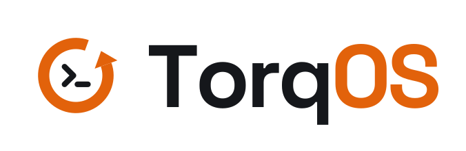
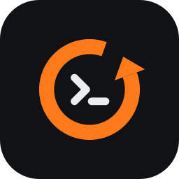
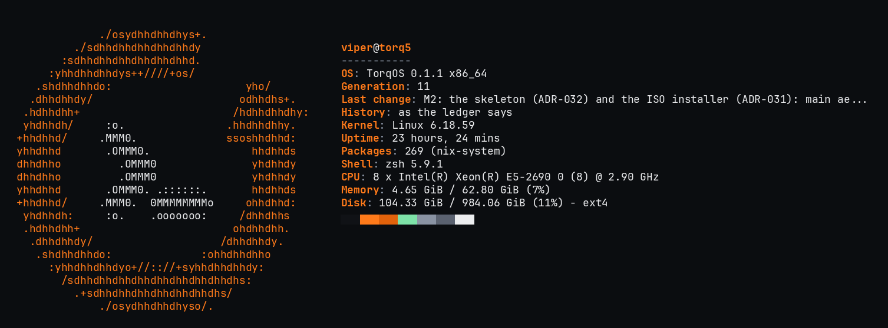

<p align="center">
  <picture>
    <source media="(prefers-color-scheme: dark)" srcset="svg/lockup/torqos-lockup-for-dark-transparent.svg">
    
  </picture>
</p>

# TorqOS brand

The TorqOS identity: the mark, the wordmark, the icons, the terminal logos and the palette, and how
TorqOS itself uses them. Everything here is a master: vector files for print and screen, the
freedesktop icon layout a system installs, and the text logos a console shows.

## The mark

<p>
  
  &nbsp;&nbsp;
  
  &nbsp;&nbsp;
  
</p>

A counter-clockwise ring around a `>_` prompt. The ring is torque — and, turning back on itself,
rollback; the prompt is how TorqOS is configured: `set`, `commit`, `rollback`. Its tagline says the
same: **set | commit | rollback**.

The wordmark sets **Torq** in the ground's text colour and **OS** in Torque orange. The horizontal
lockup (mark beside wordmark) is the default; the stacked lockup is for square spaces.

## Files

| Folder | Contents |
|---|---|
| [`svg/mark/`](svg/mark) | The mark: for dark grounds, for light grounds, black, white, and a small-size variant |
| [`svg/lockup/`](svg/lockup) | Mark and wordmark: horizontal and stacked, on dark, on light, transparent, one-colour, reversed on Torque |
| [`svg/wordmark/`](svg/wordmark) | "TorqOS" alone: for dark, for light, black, white |
| [`svg/app-icon/`](svg/app-icon) | The rounded-square app icon: graphite, torque, and a small-size variant |
| [`icons/hicolor/`](icons/hicolor) | The freedesktop icon theme layout: `torqos` (16–512 px and scalable), `distributor-logo-torqos` and its symbolic variant |
| [`terminal/`](terminal) | The mark, the wordmark and the lockup as text, ANSI colour and plain: the mark in half blocks ([`tools/text-logos.py`](tools/text-logos.py)) and in letters, as a distribution's logo is drawn ([`tools/ascii-logo.py`](tools/ascii-logo.py)), both from its SVG; and the fastfetch configuration of the SSH greeting |
| [`screenshots/`](screenshots) | The SSH greeting, as a machine shows it |
| [`favicon/`](favicon) | `favicon.ico` (16, 32, 48), `favicon.svg` (follows light and dark mode), touch and web-app icons |
| [`palette/`](palette) | The colours, as [`colors.json`](palette/colors.json) and [`colors.md`](palette/colors.md) |
| [`fonts/`](fonts) | The licence of Space Grotesk, the wordmark's typeface |
| [`package.nix`](package.nix) | `torqos-branding`: the icons and terminal logos as a system installs them |

All SVGs are self-contained: the wordmark's letters are outlines (no font needed), and they hold no
scripts, external references or embedded images. PNG renders at other sizes are made from them, for
example `rsvg-convert -w 1024 svg/app-icon/torqos-icon.svg -o torqos-icon-1024.png`.

## Colour

| | Name | Hex | Use |
|---|---|---|---|
|  | Graphite | `#101216` | Dark ground; the app icon's tile |
|  | Ink | `#15171B` | Text and one-colour marks on light grounds |
|  | Paper | `#F3F2EE` | Light ground |
|  | Torque | `#FF7A1A` | The accent on dark grounds: the ring, "OS" |
|  | Torque on light | `#E2620B` | The accent on light grounds |
|  | Foreground | `#ECEDEF` | Text and the prompt on dark grounds |
|  | Steel | `#8A93A3` | Secondary text on dark grounds |
|  | Slate | `#5B6270` | Muted interface elements |
|  | Signal green | `#7EE2A8` | "OK" states: verified, secure |

In a terminal, Torque is 256-colour `38;5;208` and the foreground bright white `97` (or `255`); Steel
is `246`, Slate `241` and Signal green `115`. The prompt uses the exact colours where the terminal
says it shows 24-bit colour (`COLORTERM`). A Linux text
console has sixteen colours and shows the nearest one.

## Type

- **Space Grotesk Bold** — the wordmark and headings.
- **JetBrains Mono** — the command line and code.

Both are under the SIL Open Font License 1.1. The wordmark in these files is already outlined, so
using the logo needs neither font installed.

## Using the mark

- **Size.** At 48 px and below, use the small variants (`torqos-mark-small.svg`,
  `torqos-icon-small.svg`): the prompt drops out so the ring stays crisp.
- **Clear space.** Keep at least the ring's thickness clear on every side.
- **Colour.** Torque `#FF7A1A` on dark grounds, `#E2620B` on light ones. Ring and prompt are never
  the same colour, except in the one-colour (black, white) versions.
- **Grounds.** Use the "for dark" files on Graphite or darker, the "for light" files on Paper or
  lighter; on photographs or busy grounds, use the app icon or a one-colour version.
- **Don't** redraw, rotate, stretch, outline, add effects to, or recolour the mark beyond the
  versions here, or set the wordmark in another typeface.

## In TorqOS

TorqOS uses these files directly (`modules/branding.nix`), and the palette in its shell (`modules/shell.nix`):
the prompt, the command line's highlighting and suggestions, and fzf.

| Where | What |
|---|---|
| `/etc/os-release`, `/etc/lsb-release` | `NAME=TorqOS`, `ID=torqos`, `ID_LIKE=nixos`, the version, `LOGO=distributor-logo-torqos`, `ANSI_COLOR="38;5;208"` |
| The boot menu and boot messages | Entries and lines name TorqOS |
| The console before login (`/etc/issue`) | The lockup (mark and wordmark), the version, the host name and terminal |
| First-boot setup, the ISO installer | The lockup over the welcome |
| The shell | The prompt in Torque, Foreground, Steel and Slate; commands that exist in Signal green |
| An SSH login | The mark in letters and what the machine is (generation, last change, whether it is as its ledger says), with the palette: fastfetch with `terminal/fastfetch-config.jsonc`, also `/etc/xdg/fastfetch/config.jsonc`. `set torq shell sshGreeting false` turns it off; `~/.hushlogin`, for one person |
| A desktop, when enabled | The icons, installed in `share/icons/hicolor` |

<p align="center"></p>

The mark in letters is made to be round in a terminal, whose cells are about twice as tall as wide:
`tools/ascii-logo.py --png` renders it in a monospace font and measures the ring, which must keep the
SVG's own proportions (1.05 wide for 1 tall, the arrowhead included).

## Using the files elsewhere

- **A website.** Put `favicon/` at the site's root and link it:
  ```html
  <link rel="icon" href="/favicon.svg" type="image/svg+xml">
  <link rel="icon" href="/favicon.ico" sizes="any">
  <link rel="apple-touch-icon" href="/apple-touch-icon.png">
  ```
- **A Linux desktop.** Install `icons/hicolor/` into `share/icons/hicolor/` (on NixOS, from a
  package, as `package.nix` does), then refresh the icon cache.
- **A terminal.** `cat terminal/torqos-lockup-ansi.txt`, `terminal/torqos-logo-ansi.txt`,
  `terminal/torqos-logo-ascii-ansi.txt` or `terminal/torqos-wordmark-ansi.txt`; the plain files have
  no colour codes. `fastfetch --config terminal/fastfetch-config.jsonc` (with the logo where the
  configuration names it) is the greeting.

## Licence and trademark

The files here are part of TorqOS and under its [Apache License 2.0](../LICENSE). That licence covers
the files; it does not grant permission to use the TorqOS name or logo as a trademark (its
section 6). Use them to refer to TorqOS, accurately and without suggesting endorsement. Space Grotesk
is under the SIL Open Font License 1.1 ([`fonts/SpaceGrotesk-OFL.txt`](fonts/SpaceGrotesk-OFL.txt)).
